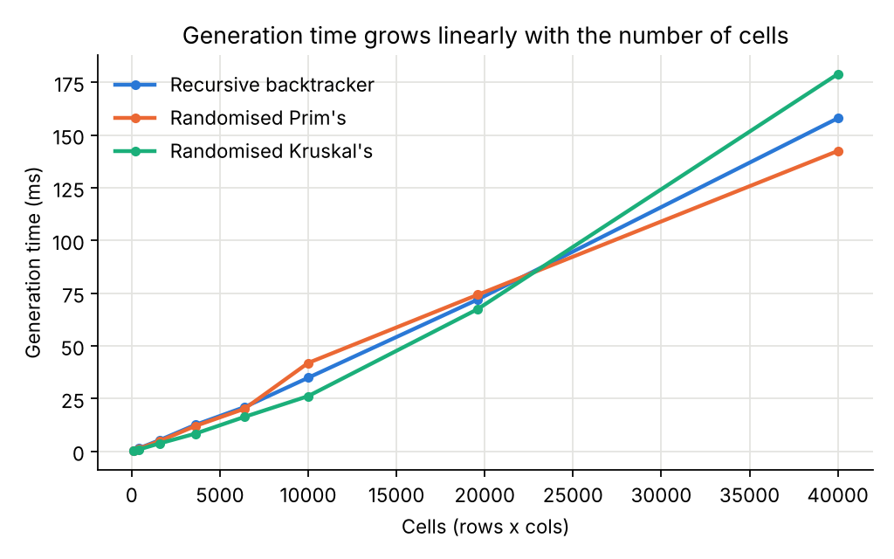
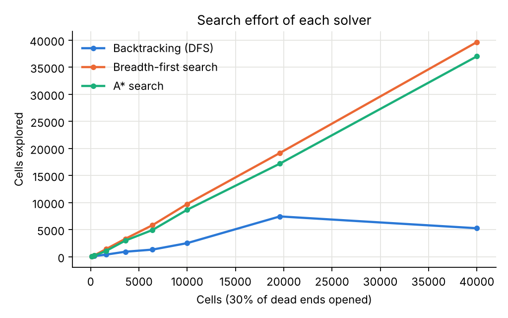
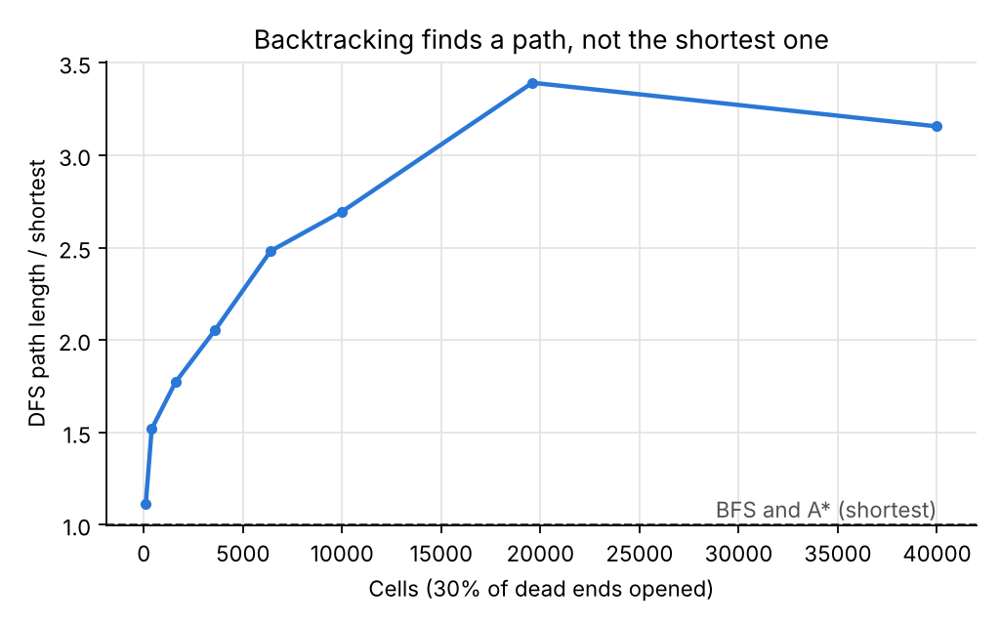

# Adaptive Maze Generation using Backtracking for Cognitive Skill Assessment

**Course:** CS3101 Design and Analysis of Algorithms, VIT Pune
**Project topic (from syllabus):** Creation of Maze using backtracking
**Prototype name:** MazeMind Assessment Lab

---

## Abstract

Maze tests such as the Porteus Maze Test are used by psychologists to measure planning and foresight in children, in people with ADHD and in older adults with early dementia. Printed tests contain a small fixed set of mazes, so a person taking the test again can remember them, and the difficulty steps between mazes are coarse.

This project builds an adaptive maze test. Every maze is generated fresh with the **recursive backtracker** (randomised depth-first search with backtracking), so the supply of test items is unlimited. The difficulty of each maze is measured with a graph metric, and the size of the next maze adapts to the person's last result using a staircase rule. We prove that the generator always produces a *perfect maze* (a spanning tree of the grid), show that it runs in O(R·C) time, compare it with randomised Prim's and Kruskal's algorithms, and compare backtracking against BFS and A* for solving.

---

## 1. Problem statement

Design an algorithm that, given a grid of R × C cells, produces a random maze in which every cell is reachable and there is exactly one route between any two cells. Use it to build a test that:

1. never repeats a maze,
2. controls difficulty so that two mazes at the same level are equally hard,
3. scores how well a person plans a route, and
4. raises or lowers the difficulty after each attempt.

## 2. Objectives

- Implement maze creation with backtracking, both recursively and with an explicit stack.
- Prove correctness (the output is a spanning tree) and derive time and space complexity.
- Measure running time and maze properties experimentally.
- Compare with two greedy MST-based generators (Prim's, Kruskal's).
- Compare backtracking (DFS) with BFS and A* for finding a route.
- Build an interactive, presentable application around the algorithms.

## 3. Mapping to the syllabus

| Syllabus unit | Where it appears in the project |
|---|---|
| Unit I: asymptotic analysis, DFS/BFS, proving correctness | Complexity analysis, correctness proof, BFS for shortest route and metrics |
| Unit II: recursion, randomised algorithms | Recursive generator, recursion-depth experiment, randomised choice of neighbour |
| Unit IV: backtracking | Maze generation and DFS solving are both backtracking |
| Unit IV: greedy (MST) | Randomised Prim's and Kruskal's (union-find) for comparison |
| Course outcome 6: data structures + paradigms | Stack, queue, binary heap, union-find, bitmask walls |

## 4. System design

```
web/core.js      algorithms: generators, solvers, metrics, scoring, staircase rule
web/app.js       user interface: assessment, generator animation, solver race, benchmark
web/index.html   the application (open in any browser, no install)
python/maze.py   same algorithms in Python, with a command-line demo
python/benchmark.py  experiments that produce the tables and charts in this report
python/test_maze.py  18 automated correctness tests
web/test_core.js     16 automated tests of the JavaScript algorithms (run with Node)
```

**Representation.** The maze is stored as an array of R·C bytes. Each byte holds the cell's four walls as bits (N = 1, E = 2, S = 4, W = 8). Removing a wall clears one bit in each of the two neighbouring cells. Viewed as a graph, cells are vertices and removed walls are edges. This uses O(R·C) memory and checks a wall in O(1).

## 5. Algorithms

### 5.1 Maze creation by backtracking

```
procedure GENERATE(R, C):
    mark every cell unvisited; every wall present
    push start cell onto stack S; mark it visited
    while S is not empty:
        cell ← top(S)
        U ← unvisited neighbours of cell
        if U is not empty:
            n ← random element of U
            remove the wall between cell and n
            mark n visited; push n onto S
        else:
            pop S                      // dead end: backtrack
```

The recursive form is the same: `carve(cell)` marks the cell, then for each neighbour in random order, if it is unvisited, removes the wall and calls `carve(neighbour)`. Returning from the call is the backtrack.

### 5.2 Proof of correctness

**Claim.** GENERATE produces a perfect maze, meaning a spanning tree of the grid graph. Therefore there is exactly one simple route between any two cells.

1. **No cycles.** A wall is removed only between the current cell and an *unvisited* cell n, which then becomes visited. Each new edge joins one new vertex to the existing visited set, so the carved passages always form a tree.
2. **Every cell is visited.** Suppose some cell is never visited. The grid is connected, so there is a visited cell v next to an unvisited cell u. Every visited cell is pushed once and popped only when it has no unvisited neighbours. Cells never become unvisited again, so v could not have been popped while u was unvisited. But the loop ends only when the stack is empty, so v was popped. This is a contradiction.
3. From 1 and 2 the passages form a tree on all R·C cells, so there are exactly R·C − 1 passages and one route between any two cells. The program checks this property directly (`isPerfect`: passages = V − 1 and BFS reaches all V cells). Every maze generated in the tests and experiments passed, including 30 random grid shapes per generator in both the Python and the JavaScript unit tests.

### 5.3 Complexity

Let V = R·C cells and E ≤ 2V possible inner walls.

- Each cell is pushed exactly once and popped exactly once, so there are 2V − 1 loop iterations.
- Each iteration inspects at most 4 neighbours, which takes O(1).
- **Time: Θ(V) = Θ(R·C).** No algorithm can do better, since every cell must be visited at least once (Ω(V)).
- **Space: O(V)** for the visited array, the walls and the stack. In the worst case the stack holds every cell.

The recursive version has the same time complexity, but its call depth equals the stack size. That depth can reach V, which causes a stack overflow on large grids (see 6.4).

| Algorithm | Time | Extra space |
|---|---|---|
| Backtracker (generation) | O(R·C) | O(R·C) stack |
| Randomised Prim's | O(R·C) expected | O(R·C) frontier |
| Randomised Kruskal's | O(R·C · α(R·C)) | O(R·C) union-find |
| DFS / BFS solve | O(R·C) | O(R·C) |
| A* solve (binary heap) | O(R·C · log(R·C)) | O(R·C) |
| One assessment trial (k = 9 candidates) | O(k · R·C) | O(R·C) |

### 5.4 Comparison generators (greedy, Unit IV)

- **Randomised Prim's:** start from one cell, keep a list of frontier walls, repeatedly remove a random one that leads to a new cell. This is Prim's MST algorithm with random edge weights.
- **Randomised Kruskal's:** shuffle all inner walls, remove a wall when the cells on either side are in different sets, then union the sets. This is Kruskal's MST algorithm with union-find (path compression and union by rank).

Both also produce spanning trees, but with a very different shape. They give many short dead ends, while the backtracker gives long winding corridors (see 6.2).

### 5.5 Solvers

- **Backtracking (DFS):** walk forward while there is an unvisited open neighbour, step back at dead ends. It finds *a* route.
- **BFS:** explores cells in order of distance from the start, so it finds the *shortest* route.
- **A\*:** BFS guided by the Manhattan distance to the exit, using a binary heap. It also finds the shortest route and usually explores fewer cells than BFS.

In a perfect maze there is only one route, so all three return the same path. To compare them fairly we "braid" the maze by opening 30% of its dead ends, which creates loops.

### 5.6 Difficulty metric

For a maze with start at the top-left and exit at the bottom-right:

- **L** = length of the shortest route (from BFS)
- **J** = number of decision points on that route, meaning cells where the person has two or more new exits to choose from

**Difficulty D = L + 3J.** A longer route takes more effort, and each decision point is a chance to go wrong.

### 5.7 Adaptive assessment

- **Levels:** 10 levels with grid sizes 5, 7, 9, 11, 13, 15, 17, 20, 23, 26. A session starts at level 3 and has 6 trials.
- **Calibration:** for each trial, 9 candidate mazes are generated and the one with the **median** D is used. This keeps difficulty consistent between trials at the same level (an O(k·V) cost).
- **Measures per trial:**
  - moves taken vs shortest possible
  - path efficiency = shortest ÷ moves taken
  - wrong turns (steps from the correct route into a side branch)
  - planning time (time before the first move)
  - wall bumps
- **Score:** 100 × efficiency − 8 × wrong turns − 2 × wall bumps, rounded to the nearest whole number (halves round up) and floored at 0. The Python and JavaScript versions use the same formula.
- **Staircase rule:** go up one level after a clean solve (0 wrong turns and efficiency ≥ 85%). Go down one level after a poor solve (3 or more wrong turns, or efficiency below 50%). Otherwise stay at the same level.
- **Summary band:** *Strong planning*, *Typical planning* or *Needs practice*, based on the final level and the mean efficiency.

The app also has a simulated participant for demonstrations. It explores like a person using DFS and takes the correct branch at each fork with a chosen probability ("skill").

## 6. Results

The measurements below come from `python/benchmark.py` (CPython 3, single thread). The web app repeats the same experiments live in the browser on the *Complexity analysis* tab.

### 6.1 Generation time

| Grid | Cells | Backtracker (ms) | Prim's (ms) | Kruskal's (ms) |
|---|---:|---:|---:|---:|
| 10 × 10 | 100 | 0.34 | 0.37 | 0.19 |
| 20 × 20 | 400 | 1.34 | 1.24 | 0.83 |
| 40 × 40 | 1,600 | 5.35 | 4.89 | 3.76 |
| 60 × 60 | 3,600 | 12.51 | 11.97 | 8.35 |
| 80 × 80 | 6,400 | 20.98 | 20.19 | 16.33 |
| 100 × 100 | 10,000 | 34.87 | 41.90 | 26.16 |
| 140 × 140 | 19,600 | 71.96 | 74.22 | 67.41 |
| 200 × 200 | 40,000 | 157.95 | 142.41 | 178.91 |



Time grows in a straight line with the number of cells, which confirms Θ(R·C). Doubling the cells from 20,000 to 40,000 roughly doubles the time (72 ms to 158 ms for the backtracker).

### 6.2 Maze character (40 × 40, 20 mazes per algorithm)

| Algorithm | Dead ends | Junctions | Shortest route as % of cells | Mean difficulty D | Perfect mazes |
|---|---:|---:|---:|---:|---:|
| Recursive backtracker | 10.2% | 9.9% | 28.9% | 558 | 20/20 |
| Randomised Prim's | 32.3% | 27.5% | 5.3% | 239 | 20/20 |
| Randomised Kruskal's | 30.3% | 26.2% | 8.9% | 366 | 20/20 |

The backtracker makes long, winding routes: the route covers about 29% of all cells, compared with 5% for Prim's. It has few dead ends, but each one is long. This makes it the best fit for a planning test, because the person must look ahead along long corridors rather than just avoid many short stubs.

### 6.3 Solving with loops (30% of dead ends opened)

| Grid | DFS explored | BFS explored | A* explored | DFS route ÷ shortest |
|---|---:|---:|---:|---:|
| 10 × 10 | 59 | 80 | 67 | 1.11× |
| 40 × 40 | 407 | 1,431 | 1,092 | 1.77× |
| 100 × 100 | 2,526 | 9,753 | 8,686 | 2.70× |
| 200 × 200 | 5,275 | 39,644 | 37,014 | 3.16× |




Backtracking explores far fewer cells, because it commits to one direction and stops as soon as it reaches the exit. However, the route it returns was 1.1 to 3.4 times longer than the shortest one, and the gap generally grows with maze size. BFS and A* always return the shortest route. A* saves 7 to 24% of the exploration compared with BFS. That saving is modest because the exit is in the far corner, so a large part of the maze lies "towards" it.

### 6.4 Recursion vs explicit stack

- The truly recursive generator failed with `RecursionError` at 50 × 50 in Python, which has a default limit of 1,000 frames. In the browser it worked up to 125 × 125 and overflowed at 150 × 150.
- The explicit-stack version built a 300 × 300 maze (90,000 cells) with no problem. Its maximum stack depth was 26,283, so about 29% of the cells were on the stack at once.
- This shows why the O(V) worst-case space bound matters in practice.

## 7. Conclusion

- The recursive backtracker is a simple, provably correct, linear-time way to generate perfect mazes.
- Its long corridors and few decision points make it well suited to testing planning ability.
- Combined with BFS-based difficulty measurement and a staircase rule, it gives an assessment that never repeats a maze and adapts to the person.
- The experiments confirm the Θ(R·C) bound and show the trade-off between backtracking (cheap, but not shortest) and BFS/A* (shortest, but explores more).

## 8. Future scope

- Validate the scoring against a standard test with real participants (this prototype is not a clinical instrument).
- Add more measures, such as hesitation at decision points and the time spent in dead ends.
- Control the difficulty directly by biasing the backtracker (for example, preferring straight runs) instead of choosing between candidates.
- Add 3D or hexagonal mazes, and store sessions for progress tracking over weeks.

## 9. References

1. T. H. Cormen, C. E. Leiserson, R. L. Rivest, and C. Stein, *Introduction to Algorithms*, 3rd ed. PHI, 2009 (DFS, BFS, MST, union-find).
2. J. Kleinberg and É. Tardos, *Algorithm Design*. Pearson, 2005.
3. S. Dasgupta, C. H. Papadimitriou, and U. V. Vazirani, *Algorithms*. McGraw-Hill, 2006.
4. P. E. Hart, N. J. Nilsson, and B. Raphael, "A formal basis for the heuristic determination of minimum cost paths," *IEEE Trans. Systems Science and Cybernetics*, vol. 4, no. 2, 1968 (A*).
5. S. D. Porteus, *The Porteus Maze Test and Intelligence*. Pacific Books, 1950.
6. J. Buck, *Mazes for Programmers*. Pragmatic Bookshelf, 2015.

---

## Appendix A: Likely viva questions

**Why is it called backtracking?** When the current cell has no unvisited neighbours, the algorithm goes back to the previous cell on the stack and tries another direction. This is the same "try, fail, undo, try another option" pattern used for N-Queens and Sudoku.

**Why is the maze guaranteed to have no loops?** A wall is only removed towards an unvisited cell, so every new passage adds a new cell to a tree. A loop would need a passage between two cells that are already connected, and that never happens.

**What is the time complexity and why?** Θ(R·C). Every cell is pushed and popped exactly once, and each step checks at most 4 neighbours.

**Why use an explicit stack instead of recursion?** The recursion depth can be as large as the number of cells. The recursive version crashed at 50 × 50 in Python and at 150 × 150 in the browser, while the stack version handled 300 × 300.

**How is this different from Prim's and Kruskal's?** All three build a random spanning tree. The backtracker goes deep first, so it gives long corridors and few dead ends. Prim's and Kruskal's grow evenly, so they give many short dead ends (32% vs 10%).

**Why not use DFS to find the shortest path?** DFS returns the first route it finds. When a maze has loops, that route was up to 3.4 times longer than the shortest one in our tests. BFS explores in order of distance, so its first route to the exit is the shortest.

**Why is A\* faster than BFS?** It expands cells in order of distance travelled plus estimated distance left (Manhattan distance). Cells that lead away from the exit are expanded later or not at all. The Manhattan distance never overestimates, so A* still finds the shortest route.

**How do you keep the difficulty fair between trials?** Nine mazes are generated for the level, and the one with the median difficulty D = L + 3J is used.

**What is the real-world use?** Repeatable, non-memorisable maze tests for planning ability, used for example in school screening, ADHD assessment and dementia screening, with difficulty that adapts to the person.
